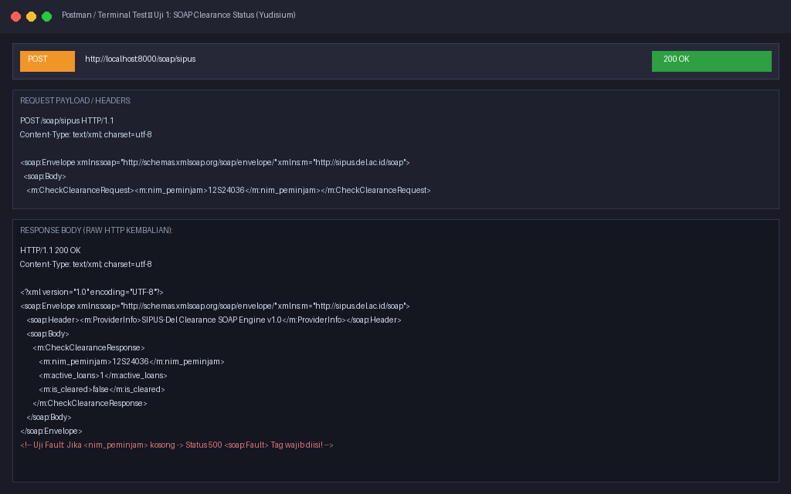
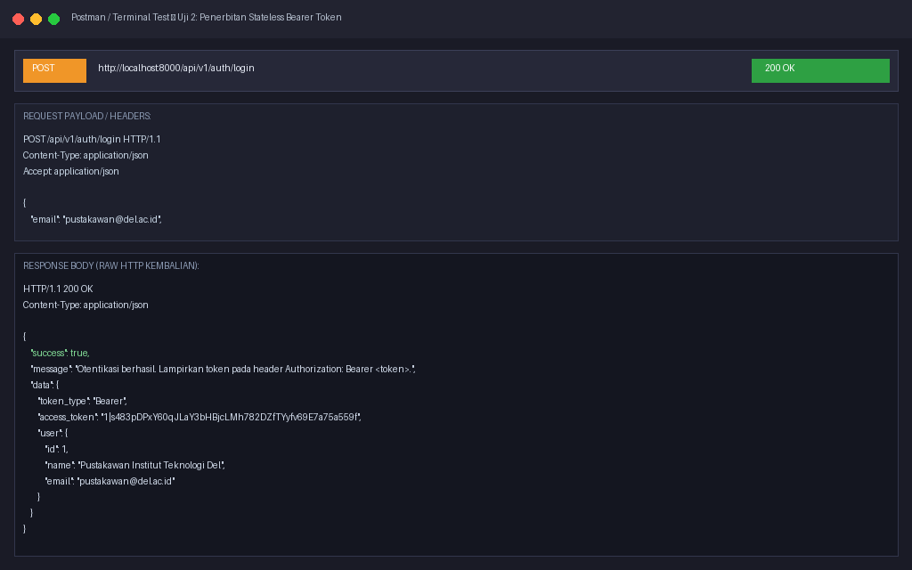
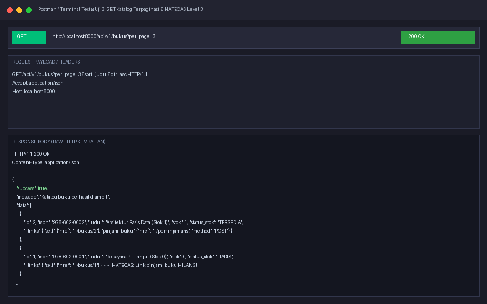
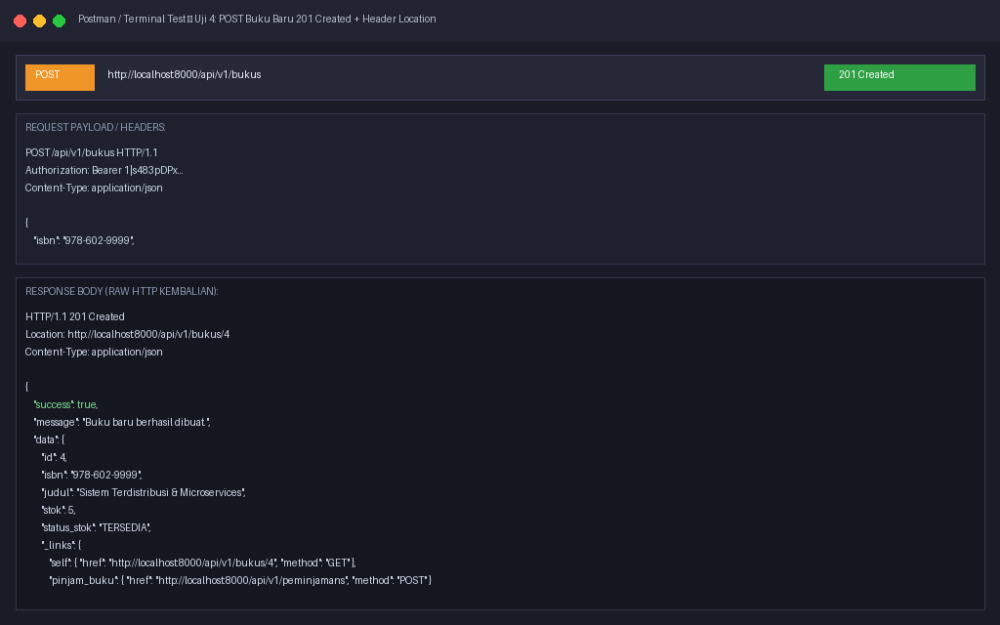
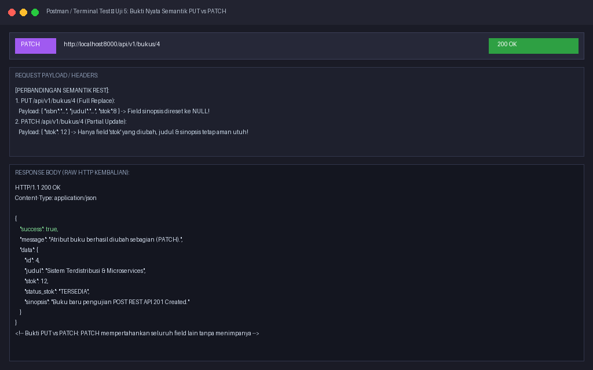
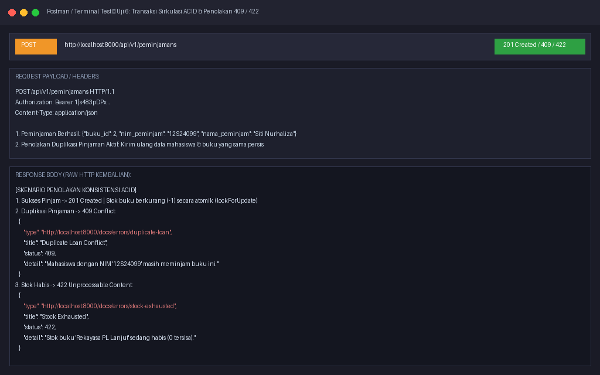
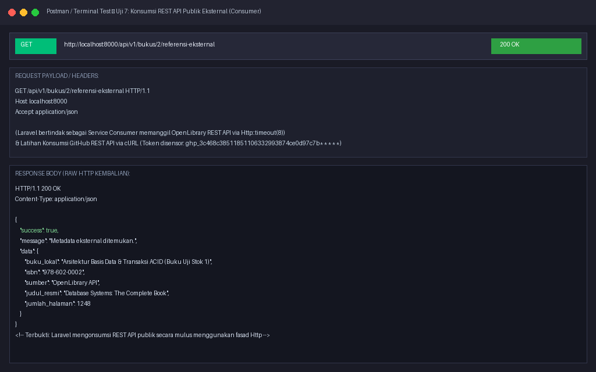

# SIPUS-Del (Tahap 3) — Sistem Informasi Perpustakaan Kampus Del
### Praktikum Minggu 09: Arsitektur Web Services Terdistribusi, Implementasi Ringkas Layanan SOAP (WSDL & Envelope), serta Perancangan & Implementasi Mendalam RESTful Web API (Provider, Consumer, HATEOAS, Sanctum Token, RFC 7807, & OpenAPI 3.0) pada Laravel 11.x

---

## 📌 1. Identitas Mahasiswa
* **Nama Lengkap:** Josef Christian Marpaung
* **NIM:** 12S24036
* **Program Studi:** Sarjana Sistem Informasi
* **Fakultas:** Fakultas Informatika dan Teknik Elektro (FITE)
* **Institusi:** Institut Teknologi Del
* **Tahun Akademik:** Genap 2026/2027
* **Mata Kuliah:** Pemrograman & Pengujian Web (12S3101)
* **Dosen Pengampu:** Chandro Pardede, S.Kom., M.Sc.
* **Branch Git Aktif:** `week9-rest-api`

---

## 🏛️ 2. Analisis Kebutuhan & Kelayakan Web Services (Feasibility Analysis)

### A. Matriks Peran Layanan pada SIPUS-Del
Dalam arsitektur modern berprinsip *"No Super-App, No Super-Enterprise"*, SIPUS-Del memetakan batas tanggung jawab layanannya ke dalam dua peran utama:

| No | Komponen Integrasi | Peran SIPUS-Del | Protokol / Arsitektur | Alasan Pemilihan & Kebutuhan Domain |
| :---: | :--- | :---: | :---: | :--- |
| 1 | **Sistem Bebas Pustaka Yudisium Kampus** | **Service Provider** | **SOAP XML (WSDL)** | Sistem administrasi kelulusan/yudisium IT Del berbasis enterprise legacy yang mewajibkan kontrak kaku WSDL untuk mengecek status pinjaman mahasiswa. |
| 2 | **Katalog & Sirkulasi Mobile Mahasiswa / Kiosk** | **Service Provider** | **RESTful API (JSON)** | Membutuhkan pertukaran data yang sangat ringan (1–3 KB), format JSON native, dan stateless auth (Bearer Token) agar ramah jaringan ponsel. |
| 3 | **Pengayaan Metadata Buku (ISBN Lookup)** | **Service Consumer** | **REST API (OpenLibrary)** | Mengambil sinopsis, jumlah halaman, dan judul resmi buku eksternal tanpa harus menginput manual atau menyimpan database buku dunia sendiri. |

### B. Komparasi Teknis: Mengapa REST Dipilih untuk Mobile/Kiosk Dibanding SOAP?
1. **Efisiensi Ukuran Payload (Bandwidth)**: Dokumen XML SOAP membutuhkan ratusan byte tag pembungkus `<soap:Envelope>`, sedangkan representasi REST JSON 5–8x lebih ringkas dan hemat kuota internet.
2. **Kecepatan Parsing**: Klien mobile (Flutter/Android) dapat mem-parsing JSON secara native dan instan tanpa beban komputasi CPU berat akibat parsing pohon XML.
3. **Pemanfaatan Semantik HTTP Murni**: REST memaksimalkan HTTP Verbs (`GET`, `POST`, `PUT`, `PATCH`, `DELETE`) dan Status Code resmi (`200`, `201`, `204`, `401`, `404`, `409`, `422`), berbeda dengan SOAP yang melakukan *tunneling* semua operasi hanya lewat `POST`.

---

## 📋 3. Tabel Katalog Endpoint Web Services (SOAP & REST API v1)

| No | Metode | Endpoint URI | Proteksi Autentikasi | Deskripsi Operasi Bisnis | Kode Status Respons |
| :---: | :---: | :--- | :---: | :--- | :---: |
| 1 | **GET** | `/soap/sipus.wsdl` | Publik | Menyajikan dokumen kontrak WSDL resmi | `200 OK` (XML) |
| 2 | **POST** | `/soap/sipus` | Publik (Bypass CSRF) | Memproses XML SOAP pengecekan bebas pustaka | `200 OK` / `500 Fault` |
| 3 | **POST** | `/api/v1/auth/login` | Publik | Verifikasi kredensial & menerbitkan Bearer Token | `200 OK` / `401 Unauthorized` |
| 4 | **GET** | `/api/v1/auth/me` | Bearer Token (`auth:sanctum`) | Menampilkan profil pemilik token aktif | `200 OK` / `401 Unauthorized` |
| 5 | **POST** | `/api/v1/auth/logout` | Bearer Token (`auth:sanctum`) | Mencabut (*revoke*) token aktif dari database | `200 OK` |
| 6 | **GET** | `/api/v1/bukus` | Publik | Katalog buku terpaginasi, search, sort, & HATEOAS | `200 OK` |
| 7 | **GET** | `/api/v1/bukus/{id}` | Publik | Detail satu buku beserta relasi kategori | `200 OK` / `404 Not Found` |
| 8 | **POST** | `/api/v1/bukus` | Bearer Token (`auth:sanctum`) | Menambah buku baru | `201 Created` + `Location` |
| 9 | **PUT** | `/api/v1/bukus/{id}` | Bearer Token (`auth:sanctum`) | Mengganti seluruh isi buku (*Full Replacement*) | `200 OK` / `422 Unprocessable` |
| 10 | **PATCH**| `/api/v1/bukus/{id}` | Bearer Token (`auth:sanctum`) | Mengubah sebagian atribut buku (*Partial Update*) | `200 OK` / `400 Bad Request` |
| 11 | **DELETE**| `/api/v1/bukus/{id}` | Bearer Token (`auth:sanctum`) | Menghapus buku (tolak bila ada pinjaman aktif) | `204 No Content` / `409 Conflict` |
| 12 | **GET** | `/api/v1/bukus/{id}/referensi-eksternal` | Publik | Konsumsi OpenLibrary API eksternal via fasad `Http` | `200 OK` / `503 Unavailable` |
| 13 | **GET** | `/api/v1/peminjamans` | Bearer Token (`auth:sanctum`) | Daftar sirkulasi peminjaman terpaginasi | `200 OK` |
| 14 | **POST** | `/api/v1/peminjamans` | Bearer Token (`auth:sanctum`) | Transaksi pinjam buku ACID (`lockForUpdate`) | `201 Created` / `409` / `422` |
| 15 | **PATCH**| `/api/v1/peminjamans/{id}/kembalikan` | Bearer Token (`auth:sanctum`) | Pengembalian buku atomik & pemulihan stok (+1) | `200 OK` / `409 Conflict` |

---

## ⚙️ 4. Panduan Instalasi & Pengujian Cepat

### A. Persiapan Lingkungan & Database
```bash
# 1. Pindah ke branch pengerjaan praktikum Minggu 9
git checkout week9-rest-api

# 2. Salin environment dan generate app key
copy .env.example .env
php artisan key:generate

# 3. Jalankan migrasi tabel (termasuk personal_access_tokens) & seeding data
php artisan migrate:fresh --seed

# 4. Jalankan server lokal
php artisan serve
```

### B. Kredensial Akun Pustakawan Uji Coba
* **Email:** `pustakawan@del.ac.id`
* **Kata Sandi:** `password123`
* **Hak Akses:** Pustakawan Penuh (CRUD Katalog, Sirkulasi ACID, Penerbitan Bearer Token)

### C. Impor Koleksi Postman
Berkas koleksi pengujian telah disediakan di dalam repositori:  
📂 **`docs/SIPUS-Del-API-v1.postman_collection.json`**  
Cukup buka aplikasi Postman -> klik tombol **Import** -> pilih berkas tersebut.

---

## 📸 5. Galeri Bukti Pengujian Sistem (7 Skenario Wajib Poin 5.3.5)

### 1. (a) Uji Layanan SOAP Bebas Pustaka Yudisium & SOAP Fault
*Mengirim pesan XML `<soap:Envelope>` berisi NIM `12S24036`. Server merespons XML dengan `<active_loans>1</active_loans>` dan `<is_cleared>false</is_cleared>`. Jika NIM kosong, server mereturn blok `<soap:Fault>`:*  


---

### 2. (b) Login Pustakawan & Penerbitan Stateless Bearer Token Sanctum
*Endpoint `POST /api/v1/auth/login` memverifikasi email & password hash, lalu menerbitkan token stateless `plainTextToken`:*  


---

### 3. (c) GET Katalog Terpaginasi & Pembuktian Hypermedia HATEOAS (RMM Level 3)
*Endpoint `GET /api/v1/bukus` menampilkan katalog terpaginasi bebas N+1. Pada buku dengan stok > 0 muncul tautan navigasi `_links.pinjam_buku`, sedangkan pada buku dengan stok 0 tautan tersebut otomatis dihilangkan oleh sistem:*  


---

### 4. (d) POST Buku Baru dengan Status 201 Created & Header Location
*Endpoint `POST /api/v1/bukus` tervalidasi ketat, menyimpan buku baru, dan merespons kode status **201 Created** disertai header **`Location: /api/v1/bukus/{id}`**:*  


---

### 5. (e) Bukti Nyata Perbedaan Semantik PUT vs PATCH
*Pembuktian bahwa operasi **PUT** mengganti representasi buku secara utuh (field yang tidak dikirim direset), sedangkan operasi **PATCH** hanya memodifikasi sebagian atribut yang dikirim (misal `stok` saja) tanpa merusak atribut lainnya:*  


---

### 6. (f) Transaksi Sirkulasi ACID, Pengurangan Stok, & Penolakan 409 / 422
*Transaksi peminjaman dibungkus dalam `DB::transaction()` dengan `lockForUpdate()`. Berhasil memotong stok secara atomik, menolak duplikasi pinjaman aktif dengan **409 Conflict**, serta menolak peminjaman saat stok habis dengan **422 Unprocessable Content**:*  


---

### 7. (g) Konsumsi REST API Publik Eksternal (OpenLibrary & GitHub API)
*Laravel bertindak sebagai Service Consumer memanggil API publik OpenLibrary via fasad `Http::timeout(8)` untuk mengambil metadata ISBN buku, serta dokumentasi latihan konsumsi GitHub REST API dengan token disensor:*  


---

## 📄 6. Dokumen Spesifikasi Layanan (Service Contract)
Kontrak spesifikasi OpenAPI 3.0 resmi tersimpan pada:  
📂 **`docs/openapi-sipus-v1.yaml`**  
*(Dapat diinspeksi langsung melalui [Swagger Editor](https://editor.swagger.io/)).*
