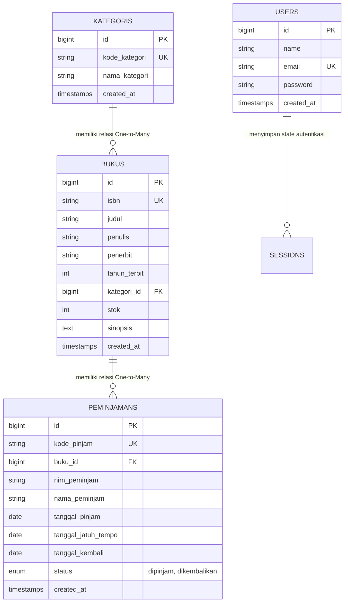
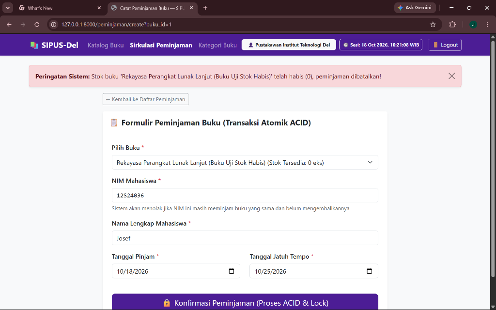
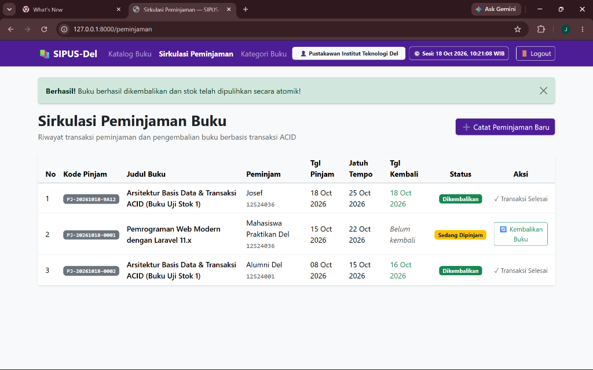
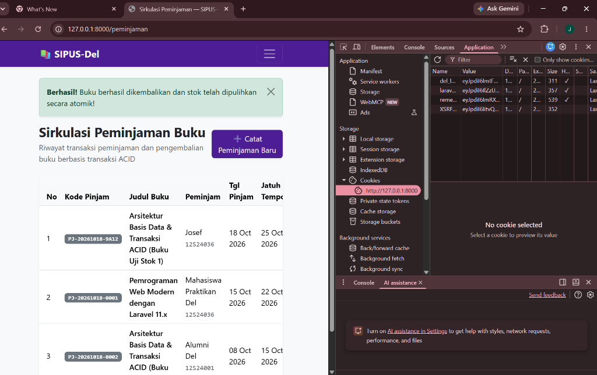

# SIPUS-Del (Tahap 2) — Sistem Informasi Perpustakaan Kampus Del
### Praktikum Minggu 06: Konektivitas Basis Data Persisten, Transaksi ACID & Concurrency Locking, Fluent Query Builder, serta Manajemen Sesi & Autentikasi

* **Mata Kuliah:** Pemrograman & Pengujian Web (12S3101)
* **Institusi:** Institut Teknologi Del — Fakultas Informatika dan Teknik Elektro
* **Tahun Akademik:** Ganjil 2026/2027
* **Dosen Pengampu:** Chandro Pardede, S.Kom., M.Sc.
* **NIM Pengembang:** 12S24036
* **Nama Pengembang:** Josef Marpaung
* **Branch Git:** `week6-db-session`

---

## 📌 1. Kredensial Akun Pustakawan Uji Coba

Sesuai spesifikasi modul, akun pustakawan telah ditanamkan melalui `DatabaseSeeder.php`:

| Parameter | Kredensial Resmi |
| :--- | :--- |
| **Alamat Email** | `pustakawan@del.ac.id` |
| **Kata Sandi (Password)** | `password123` |
| **Hak Akses** | Pustakawan Penuh (CRUD Buku, Kategori, Sirkulasi Peminjaman & Pengembalian) |

---

## 🗄️ 2. Diagram Hubungan Entitas (Entity Relationship Diagram - ERD)

Aplikasi SIPUS-Del Tahap 2 menghubungkan entitas relasional persisten pada MySQL 8.0 (InnoDB) dengan integritas referensial ketat:

---

## ⚙️ 3. Implementasi Spesifikasi Teknis Wajib

### A. Skema Tabel `peminjamans` & Relasi Eloquent (Bobot 20%)
* Tabel `peminjamans` memiliki Foreign Key `buku_id` yang terikat ke tabel `bukus` dengan aturan `cascadeOnDelete()`.
* Model `Peminjaman` mengimplementasikan `$fillable` lengkap dan relasi `belongsTo(Buku::class)`.
* Model `Buku` mengimplementasikan relasi `hasMany(Peminjaman::class)`.

### B. Transaksi Basis Data ACID & Concurrency Locking (Bobot 25%)
* **Peminjaman Buku:** Seluruh operasi dibungkus dalam `DB::transaction(..., 3)`. Baris buku dikunci menggunakan Pessimistic Locking `Buku::where('id', $id)->lockForUpdate()->firstOrFail()`.
* **Pencegahan Race Condition & Rollback Stok 0:** Jika `stok < 1`, sistem melempar `\RuntimeException` yang memicu rollback otomatis sehingga stok buku tidak pernah minus.
* **Pencegahan Duplikasi Pinjam:** Sistem memverifikasi bahwa mahasiswa dengan NIM yang sama tidak dapat meminjam buku yang sama jika belum dikembalikan.
* **Pengembalian Buku:** Dibungkus dalam `DB::transaction()` + `lockForUpdate()`, mengubah status menjadi `'dikembalikan'`, mencatat `tanggal_kembali`, serta memulihkan kuantitas stok secara atomik (`$buku->increment('stok')`).
* **Error Handling:** Menangkap `QueryException` dan mencatatnya ke `storage/logs/laravel.log` via `Log::error()`.

### C. Fluent Query Builder (`DB::table`) & Optimasi Katalog (Bobot 15%)
* **Kartu Analitik:** Menampilkan 4 kartu statistik perpustakaan menggunakan `DB::table()` (`count` judul, `sum` stok tersedia, `count` buku sedang dipinjam, dan `count` buku dikembalikan).
* **Mitigasi N+1 Problem:** Katalog buku menggunakan `Buku::with('kategori')->withCount('peminjamans')` untuk menghitung relasi peminjaman tanpa overhead kueri berulang.
* **Filter Dinamis:** Menerapkan klausa kondisional `when()` untuk pencarian berdasarkan judul, penulis, ISBN, dan filter kategori, dilengkapi paginasi `withQueryString()`.

### D. Manajemen Sesi & Autentikasi Pustakawan (Bobot 25%)
* **Autentikasi Aman:** Menggunakan `Auth::attempt()` pada `AuthController`.
* **Anti-Session Fixation:** Wajib menjalankan `$request->session()->regenerate()` saat login untuk memperbarui Session ID.
* **Logout Higienis:** Menjalankan `$request->session()->invalidate()` dan `regenerateToken()`.
* **Proteksi Middleware:** Rute mutasi data (CRUD buku/kategori, peminjaman, pengembalian) diproteksi penuh oleh middleware `auth`.
* **Manajemen State & HTTP Cookie:** Menyimpan waktu login pada Session (`login_timestamp`), riwayat pencarian terakhir (`last_search_keyword`), dan menyimpan email pengguna pada cookie aman via `Cookie::queue('del_last_user_email', ..., 10080)`.

---

## 📸 4. Bukti Pengujian Sistem (Audit Evidence)

### 1. Bukti Penolakan Transaksi ACID saat Stok = 0 (Rollback Atomik)
*Sistem menolak peminjaman buku dengan stok 0 dan menampilkan peringatan sistem:*  

### 2. Bukti Pengembalian Buku Atomik & Pemulihan Stok
*Status sirkulasi berhasil diubah menjadi Dikembalikan dan stok fisik buku bertambah otomatis:*  

### 3. Bukti Audit Cookie HttpOnly & SameSite pada Browser DevTools
*Inspeksi tab Application -> Cookies menunjukkan cookie `laravel_session` dan `del_last_user_email` terlindungi flag HttpOnly:*  

---

## 📜 5. Riwayat Commit Terstruktur (Conventional Commits)
1. `feat(migration): create peminjamans table with foreign key to bukus`
2. `feat(transaction): implement ACID book borrowing and return with lockForUpdate`
3. `feat(query-builder): add library analytics dashboard and dynamic search`
4. `feat(auth-session): implement librarian login, session regeneration, and cookies`
5. `docs: complete week 6 documentation, ERD, and ACID test audit`